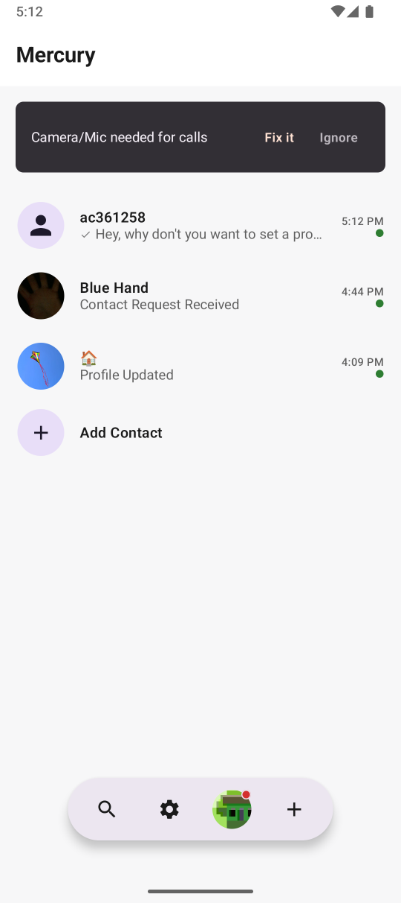
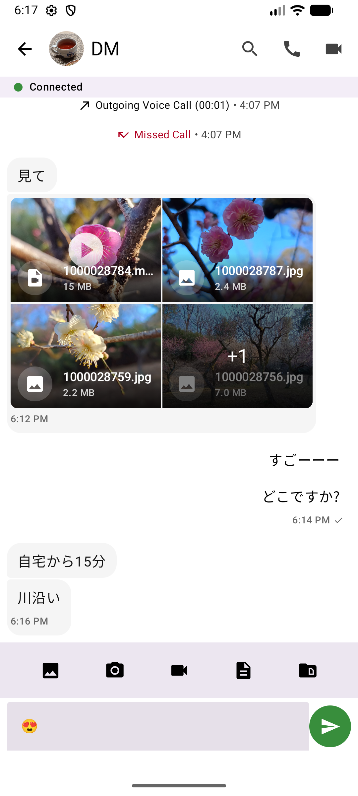
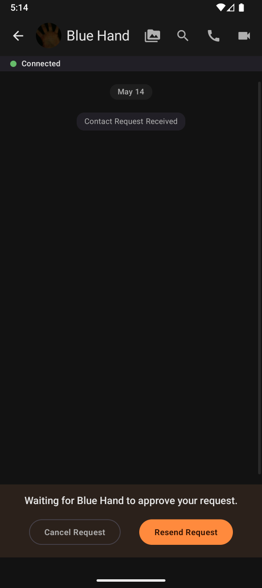
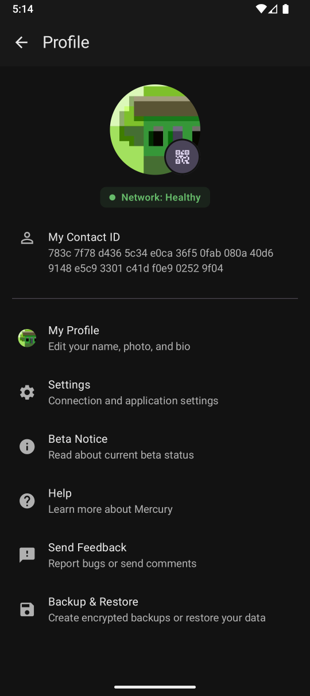

# Project Mercury

## About

Project Mercury is a private and secure cross-platform app utilizing peer-to-peer encrypted messaging and voice/video calls.

It operates without traditional registration; users are identified solely via an anonymous ID number. Text messages, voice, and video calls are fully encrypted and transferred directly between devices (P2P).

**Key Features:**

*   **Registration-Free:** Users are identified solely by an anonymous, non-linked ID number.
*   **P2P Encryption:** Text messages, voice, and video calls are fully encrypted and transferred directly device-to-device (P2P).
*   **Multi-Platform Support:** Native Android client, headless CLI client, and automated bot agents.
*   **Decentralized Discovery & Transport:** P2P peer routing and signaling built on `libp2p` and audio/video calls based on WebRTC.

---

## Architecture

## Screenshots

|  |  |  |  |
|:--:|:--:|:--:|:--:|

### Architectural Philosophy

Project Mercury is built around a strict separation of concerns where the **Core** module acts as the sole engine of the application.

The core business logic is encapsulated within a set of C++ libraries collectively known as **Eillance**. End applications (Android, CLI, Bot runners, etc.) are thin wrappers around this core. They serve as the interface and platform liaison, handling device-specific concerns (like rendering, audio/video input events, OS Telecom hooks, and platform permissions). All state management, cryptography, and network orchestration reside exclusively within the Eillance libraries.

### Component Breakdown

| Library / App | Location | Responsibility |
| :--- | :--- | :--- |
| `eillance-core` | `libs/eillance-core` | The primary module containing all application logic, identity, messaging, data models, protocol handlers, and the presentation view model. |
| `eillance-crypto` | `libs/eillance-crypto` | A dedicated cryptography layer wrapping BoringSSL for identity generation and end-to-end encrypted session establishment. |
| `eillance-libp2p` | `libs/eillance-libp2p` | Transport and network abstraction implementing `libp2p` for decentralized node discovery, routing, and signaling. |
| `eillance-rtc` | `libs/eillance-rtc` | Cross-platform WebRTC/DataChannel transport abstraction based on `libdatachannel`. |
| `eillance-capture` | `libs/eillance-capture` | Cross-platform audio and video capture pipelines, hardware abstraction, and media encoding. |
| `eillance-bot-api` | `libs/eillance-bot-api` | High-level C++ API and SDK for developing headless Mercury bots and integrations. |
| `eillance-storage-sqlite` | `libs/eillance-storage-sqlite` | Persistent storage implementation utilizing SQLite, handling database operations and schema migrations. |
| `eillance-logging` | `libs/eillance-logging` | Lightweight logging abstraction. |
| `eillance-utils` | `libs/eillance-utils` | Reusable utilities such as dispatch queues, argument parsers, threading primitives, and data structures. |
| **Android App** | `apps/android` | Native Android client built with Jetpack Compose, native C++ NDK bindings, Android Telecom framework integration, and WebRTC. |
| **CLI Client** | `apps/mercury-cli` | Terminal-based client for headless operation, automated testing, and verification. |
| **Mercury Bot** | `apps/mercury-bot` | Executable bot runner leveraging `eillance-bot-api` for automated agents and network services. |
| **Bootstrap Node** | `apps/mercury-bootstrap` | Network bootstrap and discovery node using libp2p for initial peer coordination and relaying. |

### Tech Stack

#### Key Libraries & Implementations

*   **Cross-platform Core:** C++20 (managed with CMake)
*   **Networking & Signaling:** `libp2p` via `eillance-libp2p`
*   **RTC / Data Transport:**
    *   **`libdatachannel`**: Used for CLI clients, bots, and native desktop runtimes.
    *   **Google WebRTC (`org.webrtc`)**: Used for the Android application via NDK / JNI.
*   **Database:** SQLite via `eillance-storage-sqlite`
*   **Cryptography:** BoringSSL, abstracted by `eillance-crypto`
*   **Media Capture & Encoding (`eillance-capture`):** (non-Android)
    *   **Video:** OpenCV / platform capture APIs & FFmpeg encoding
    *   **Audio:** miniaudio & Opus encoding
*   **Android Presentation:**
    *   **UI:** Jetpack Compose & Material 3
    *   **System Integration:** Android Telecom framework (CallStyle notifications, native in-call system screens)
    *   **JNI / NDK:** Custom C++ bridge bindings (`ndkio`)

#### Protocol Stack

Project Mercury utilizes real-time data and media exchange through negotiated peer-to-peer connections capable of multiplexing both secure data channels and real-time media tracks:

*   **Peer Discovery & Signaling:** libp2p (DHT / Relays)
*   **Data Channels:** SCTP (RFC 8831)
*   **Media Transport:** SRTP (RFC 8834)
*   **Security & Key Exchange:** DTLS/UDP (RFC 7350 and RFC 8261)
*   **Connection Establishment:** ICE (RFC 8445) with STUN (RFC 8489) and TURN (RFC 8656)

---

## Build

See the detailed instructions in the [build and deploy](build-and-deploy.md) section.
